# Google 登入（模擬）的實際畫面

> - 產生的版本：`f141bcc41576bac0ce2b8cfe9f6344195246df45`（分支 `claude/w1-google-login`，工作目錄乾淨），作者在 Linux 執行，2026-11-27。
> - `npm run e2e -- --upstream <path> --script e2e-login`：真正的頁面、本機 Auth／Firestore Emulator、固定版本的 API `1e20989`。
> - **模擬登入**：Auth Emulator 的 Google provider 與虛構帳號，**不是**真的 Google 登入。
> - 結果：`e2e-login-results.json`（15/15）。色彩與樣式都是暫定。

**未登入：只有「請先登入」**

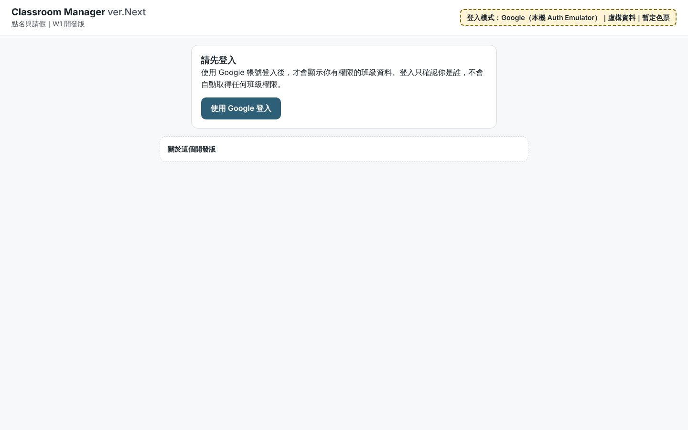

**換成其他帳號：先前帳號尚未確認的操作不會顯示或重送，只顯示提示**

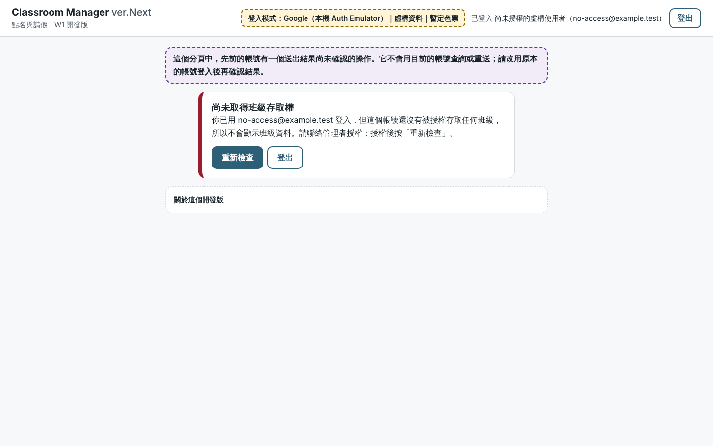

**模擬登入的帳號選擇窗（虛構帳號）**

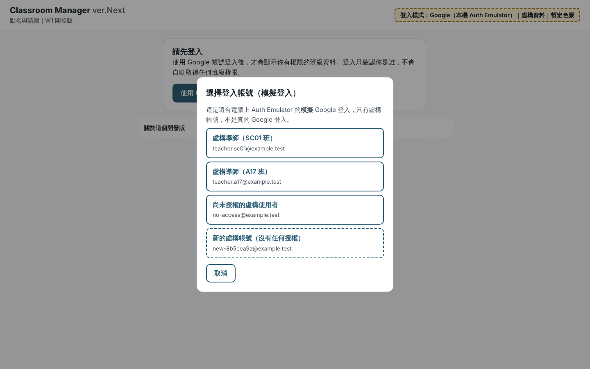

**已登入、沒有授權：「尚未取得班級存取權」**

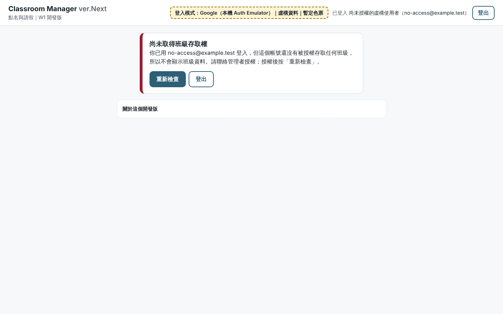

**teacher.sc01：只看到 SC01 的名冊與請假**

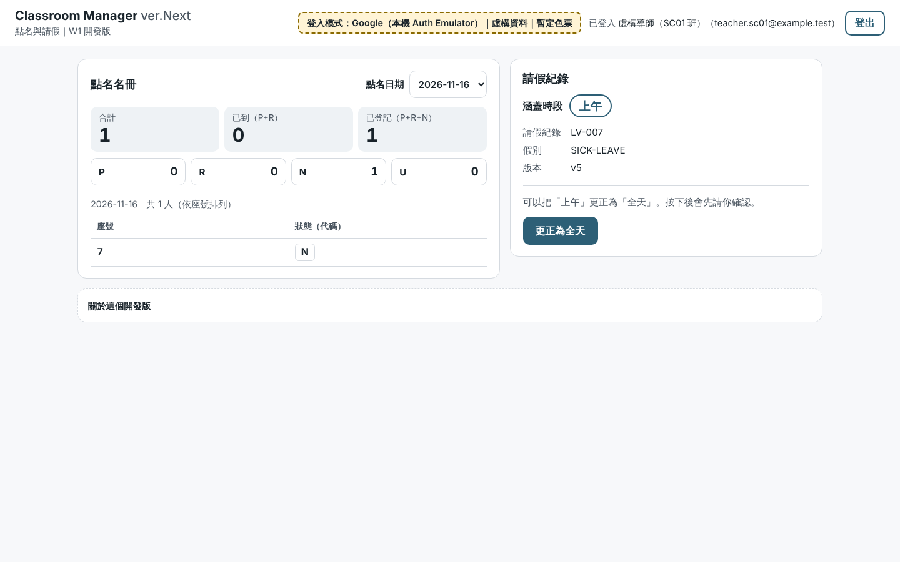

**signed-in-classroom-1024x768**

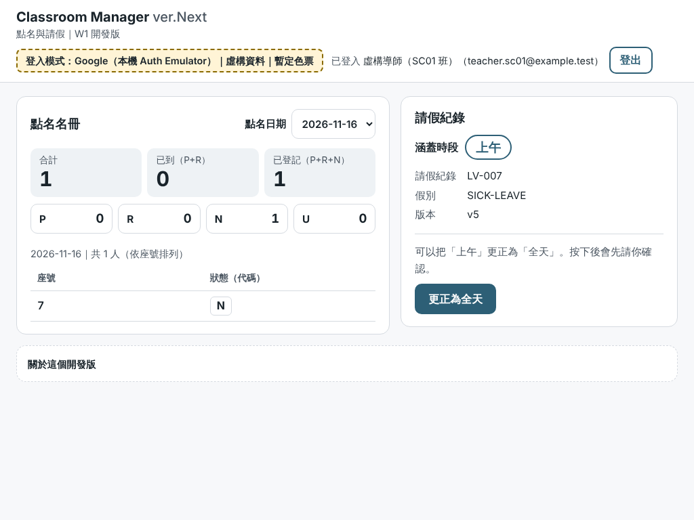

**signed-in-desktop-1440x900**

**signed-in-phone-390x844**

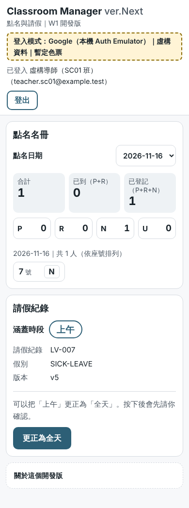

**signed-in-tablet-820x1180**

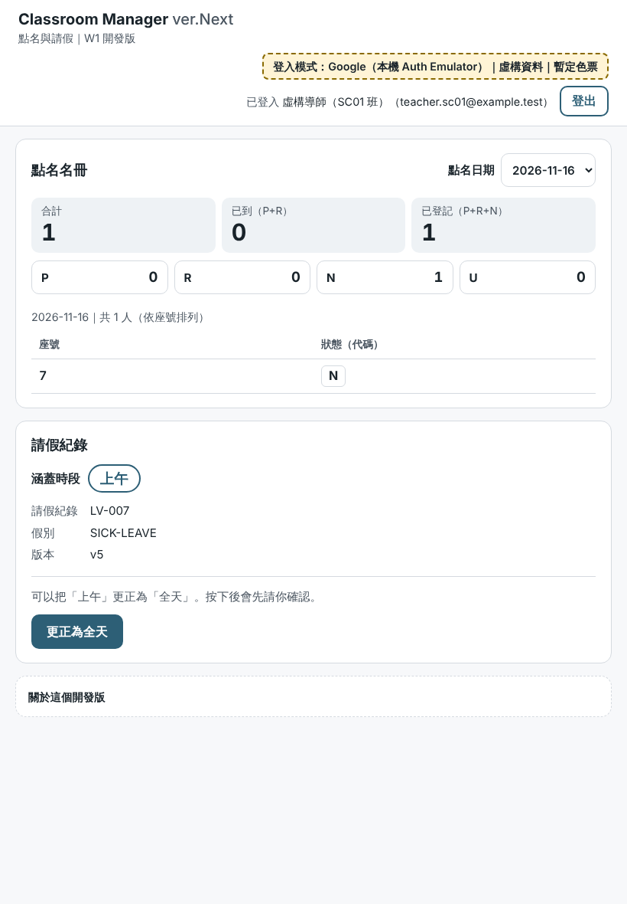

**signed-out-classroom-1024x768**

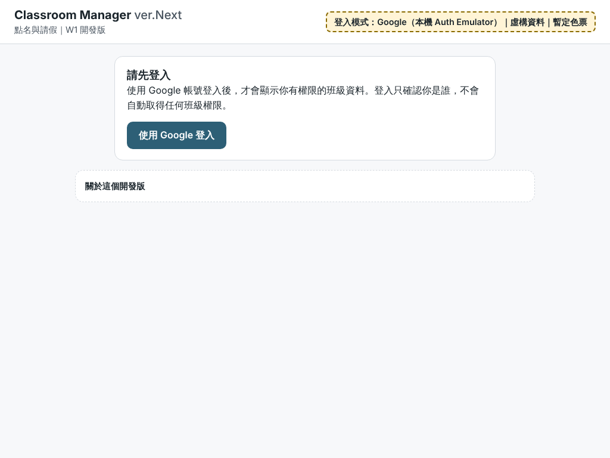

**signed-out-desktop-1440x900**

**signed-out-phone-390x844**

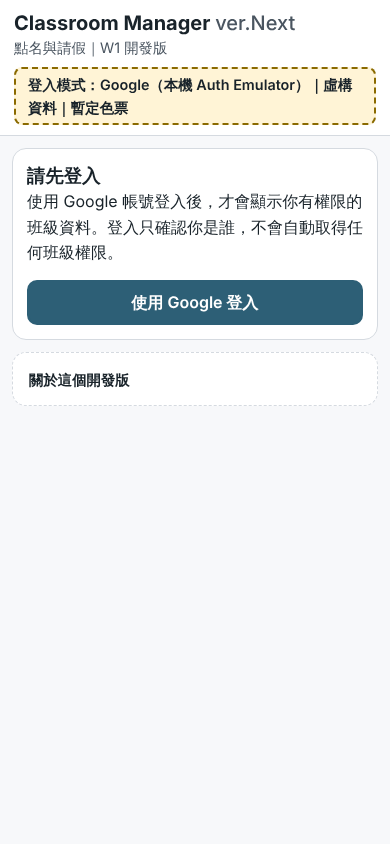

**signed-out-tablet-820x1180**

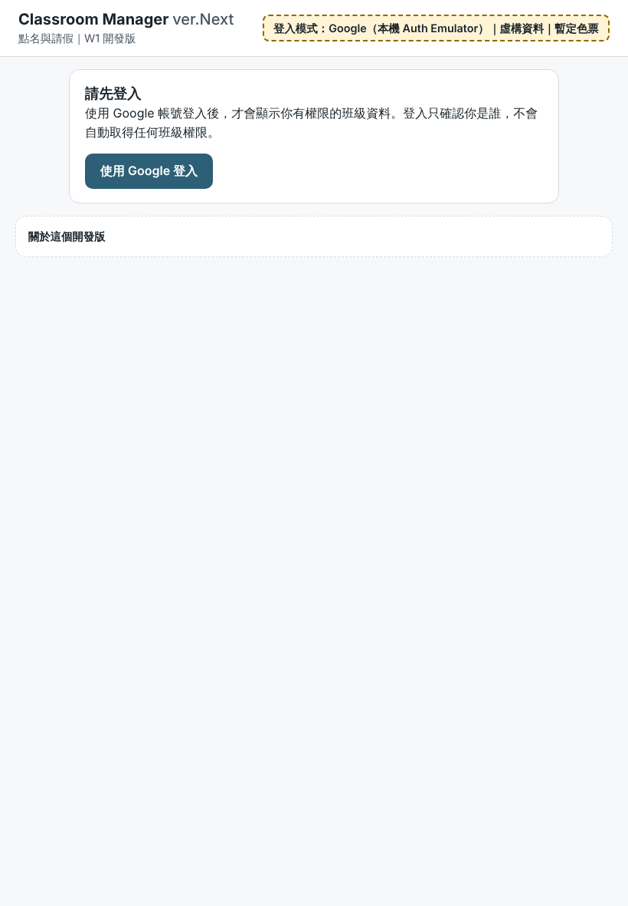
